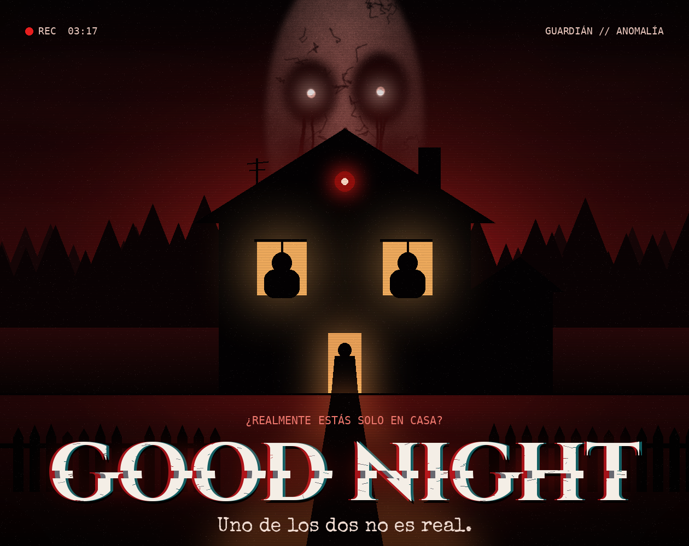

<p align="center">
  
</p>

<h1 align="center">GOOD NIGHT</h1>
<p align="center"><i>¿Realmente estás solo en casa?</i></p>

**GOOD NIGHT** es un videojuego de terror psicológico en primera persona creado para la **GameJamPlus 2026/27 (11.ª edición)**.

Una noche aparentemente tranquila se convierte en una pesadilla. El protagonista se queda solo en casa y empieza a recibir mensajes extraños, a escuchar voces familiares y a ver en las cámaras de seguridad cosas que no deberían estar ahí. Para sobrevivir tendrá que explorar la vivienda, resolver acertijos y descubrir los secretos de **GUARDIÁN**, el sistema de seguridad de la casa. Pero cuando algo puede imitar tu voz, tus recuerdos e incluso tu apariencia, la pregunta cambia: ¿quién es el original?

**Jugar:** https://santiago-habibi.itch.io/seu-jogo

---

## Características

- **5 capítulos** con puntos de control automáticos.
- **2 finales**, decididos por una elección de identidad en el capítulo 5.
- **Sistema GUARDIÁN:** cámaras de vigilancia con archivo y directo, panel de alarma, cuadro eléctrico con fusibles y consola de aislamiento.
- **Puzles ambientales:** código de alarma, fusible F2, reconstrucción de la secuencia de tres cintas VHS, llave del armario y habitación secreta 06.
- **Entidad autónoma:** patrulla por un grafo de nodos, detecta, persigue, busca y pierde al jugador cuando se esconde (armario, alacena).
- **Teléfono en primera persona:** mensajes, llamadas, objetivos y pistas.
- **Terror dinámico:** jumpscares con guion (espejo del baño, puerta principal, ventana), sonidos ambientales espaciales y capa de tensión según la cercanía de la entidad.
- **Voces** en español para los diálogos principales.

## Controles

| Acción | Tecla |
|---|---|
| Moverse | W A S D |
| Mirar | Ratón |
| Correr | Shift |
| Agacharse | Ctrl |
| Interactuar | E |
| Teléfono | Tab |
| Linterna | F |
| Pausa / salir de un panel | Esc |
| Botones de paneles y estaciones | Clic izquierdo |

## Requisitos para abrir el proyecto

- **Unity 6.3 LTS — 6000.3.26f1** (otra versión puede reimportar o cambiar archivos).
- Universal Render Pipeline 17.3.0 (se instala solo desde `Packages/manifest.json`).
- Windows 10/11 recomendado. Unos 5 GB libres para la carpeta `Library` que Unity genera la primera vez.

## Cómo abrir y ejecutar

1. Clona el repositorio:
   ```bash
   git clone https://github.com/Bohorquez-SS/Game-Jam.git
   ```
2. En **Unity Hub → Add → Add project from disk**, elige la carpeta `Game-Jam`.
3. Ábrelo con **Unity 6000.3.26f1**. La primera importación tarda varios minutos.
4. Abre la escena `Assets/_GoodNight/Scenes/GoodNight_Main.unity` y pulsa **Play**.
5. Si la escena aparece vacía o desactualizada: **Tools → GOOD NIGHT → Build Complete Game** (la casa, los actores y los sistemas se generan por código).

**Compilar para Windows:** File → Build Profiles → Windows → Build.

## Estructura

```
Assets/_GoodNight/
├── Art/          Modelos FBX, texturas
├── Audio/        Efectos, ambiente y música
├── Materials/    Materiales URP
├── Resources/    Voces y recursos cargados en ejecución
├── Scenes/       GoodNight_Main.unity
├── Scripts/
│   ├── AI/       Entidad: estados, grafo de navegación
│   ├── Core/     GameManager, AudioManager, ajustes, eventos
│   ├── Editor/   Constructores de la casa (HouseBuilder, HouseRooms, HouseActors, GameBuilder)
│   ├── Player/   Movimiento FPS, interacción, inspección
│   ├── Stations/ Alarma, cámaras, cuadro eléctrico, VHS, consola de aislamiento
│   ├── Story/    Capítulos 1–5 y finales
│   ├── Systems/  Pistas, voces, ambiente
│   ├── UI/       HUD, teléfono, menús, créditos
│   └── World/    Puertas, ventanas, cajones, espejo, escondites
└── Shaders/
Tools/            Scripts auxiliares (Blender, texturas, voces)
```

## Documentación y organización

- [Recorrido completo](WALKTHROUGH_DEVELOPERS.md): contiene spoilers, puzles y las dos decisiones finales.
- [Plan de pruebas](QA_PLAYTEST.md): observación de jugadores y comprobaciones técnicas pendientes de ejecutar en Unity.
- [Evolución del proyecto](Docs/EVOLUCION_DEL_PROYECTO.md): ocho etapas acumulativas y commits publicados realmente.
- [Verificación de la entrega](Docs/VERIFICACION_FINAL.md): comparación con `GoodNightFinal.zip`, integridad y límites de la revisión.
- [Cambios](CHANGELOG.md) y [líneas de voz](VOICE_LINES.md).
- [Miro: diseño del juego](https://miro.com/app/board/uXjVEXDjUbM=/).
- [Trello: documentación y evolución](https://trello.com/b/JUy925jS/good-night-desarrollo-del-juego).

Las cuatro verdades aportan contexto narrativo; no son un requisito para desbloquear los finales. El capítulo 5 restaura la seguridad, exige regresar a la habitación 06 y después permite elegir qué identidad aislar.

## Herramientas y flujo de recursos

| Herramienta | Uso comprobable en el proyecto |
|---|---|
| Unity 6.3 LTS + URP | Escena, iluminación, materiales, interfaz y compilación |
| C# | Jugador, estaciones, capítulos, entidad y constructores del escenario |
| Blender | Scripts de modelado/exportación en `Tools/` y modelos FBX |
| Python | Preparación de modelos, texturas, audio y voces; scripts en `Tools/` |
| Piper TTS | Voces en español, índice de generación y WAV en `Resources/Voices` |
| Git y GitHub | Historial por versiones, ramas de trabajo e integración en `dev` |
| Miro y Trello | Diseño documentado, referencias de entrega y evolución verificada |

Los scripts auxiliares se revisan antes de ejecutarlos; las rutas y dependencias de sus herramientas externas pueden requerir configuración local. La revisión estática del 20/10 no sustituyó una compilación ni una partida en Unity.

## Equipo

| Integrante |
|---|
| Kevin Mollo |
| Sebastián Condori |
| Santiago Borquez |
| David Bustos |

## Créditos de terceros y licencias

- Modelos base: **KayKit** (Kay Lousberg) — CC0.
- Síntesis de voz: **Piper** — MIT. Voces `es_ES-carlfm-x_low` (dominio público) y `es_ES-mls_10246-low` (CC BY 4.0).

---

<p align="center">Hecho para GameJamPlus 2026/27 · Unity 6.3 LTS</p>
